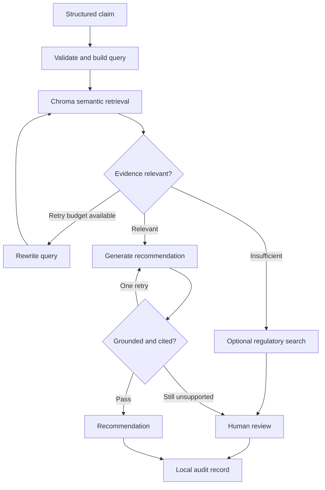

# ClaimGuard AI

**Evidence-first agentic RAG for auto-insurance claims decision support.**

ClaimGuard AI is a hackathon-derived portfolio prototype that turns unstructured insurance policy documents into traceable claim recommendations. Unlike a single LLM call, its LangGraph workflow checks retrieval quality, rewrites weak queries, verifies citations and routes uncertain outcomes to human review.

> Educational demonstration using fictional policies and synthetic claims. Not a production insurance system, legal advice, or an automated authority to approve or deny real claims.

## Architecture



## Engineering highlights

- **Document ingestion:** PDF and TXT loaders, overlapping chunks, clause identifiers and MiniLM embeddings.
- **Retrieval:** Chroma vector search with a separate index per build and bounded query refinement (maximum two retries).
- **Orchestration:** LangGraph state machine, typed Pydantic inputs and structured model outputs.
- **Grounding:** citation membership checks, LLM-based evidence grading and one bounded decision retry.
- **Human review:** insufficient evidence and unsupported decisions escalate; high-value escalations receive higher priority.
- **Observability:** local JSONL decision records and human-review queue.
- **Interface:** Streamlit structured claim form, policy index and decision trace.

## Quick start

Use Python 3.11. Model downloads and hosted inference require internet access.

```bash
python -m venv .venv
# macOS/Linux
source .venv/bin/activate
# Windows PowerShell: .venv\Scripts\Activate.ps1
python -m pip install -r requirements.txt
```

Copy `.env.example` to `.env` and supply your own Groq key, or enter it in the masked UI. Tavily is optional; web search is disabled by default. Model identifiers can be overridden via `GRADER_MODEL` and `DECISION_MODEL` environment variables if provider availability changes.

```bash
streamlit run app.py
```

1. Open the local Streamlit page and choose **Build policy index** to load the included fictional policies.
2. Enter your Groq API key if not configured already.
3. Submit the default synthetic hail claim and inspect the recommendation and cited clauses.
4. Try mechanical breakdown or an ambiguous rideshare claim using `data/evaluation_cases.json` as a guide. Expected labels are illustrative targets, not measured model results.

## Repository map

| Path | Purpose |
| --- | --- |
| `insurance_agent.py` | Ingestion, schemas, prompts, graph and audit logic |
| `app.py` | Local Streamlit demo |
| `data/policies/` | Four fictional policy sections |
| `data/evaluation_cases.json` | Example evaluation targets |
| `tests/` | Static checks and dependency-based unit tests |
| `docs/` | Design notes, limitations and release cleanup |
| `.github/workflows/ci.yml` | Proposed automated test workflow |
| `Dockerfile` | Optional container build |

## Testing

```bash
python -m unittest discover -s tests -p test_static.py -v
# After installing dependencies:
python -m unittest discover -s tests -v
```

The four static checks and Python compilation passed during packaging. Dependency-based tests, live model calls, UI execution, Docker builds and CI have not been verified. No measured accuracy, latency or cost claims are made.

## Privacy and limitations

Use synthetic data only. Hosted model providers receive claim text and retrieved policy excerpts; optional regulatory search sends the state and claim category to Tavily. Local audit logs can contain claim text and model reasoning and must not be committed. This prototype does not provide multi-user isolation, authentication, calibrated confidence, reliable legal-source verification or production-grade prompt-injection defenses. Regulatory search results are advisory only and cannot independently justify a coverage decision.

See [design notes](docs/DESIGN.md) and [release notes](docs/RELEASE.md). Obtain contributor permission before public distribution. The repository's existing license is retained; contributor permission is still required for public distribution.
